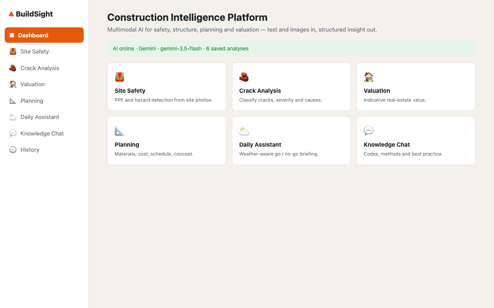
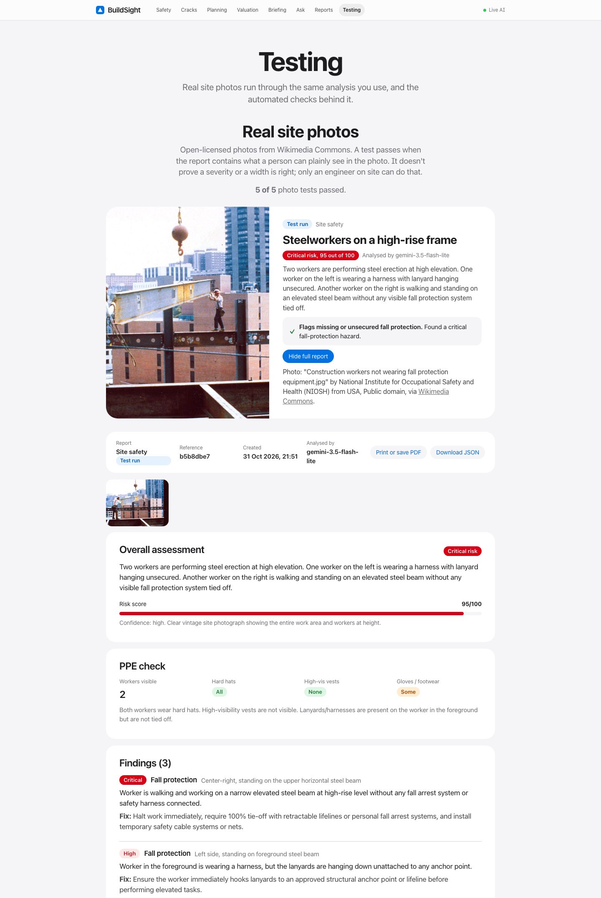
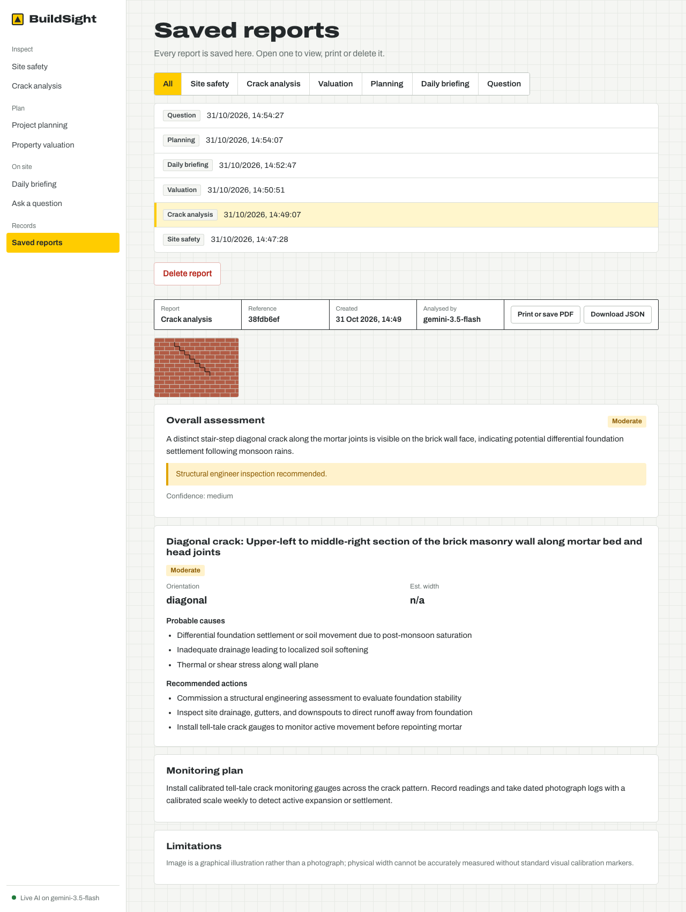
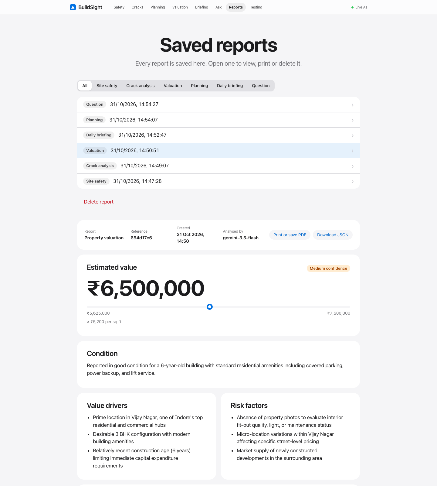
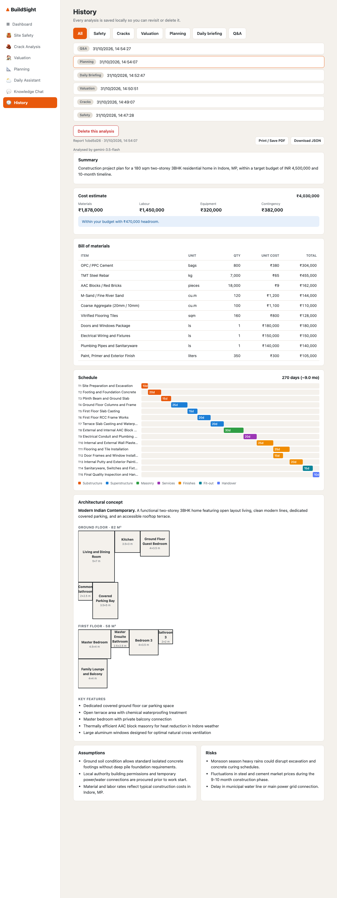
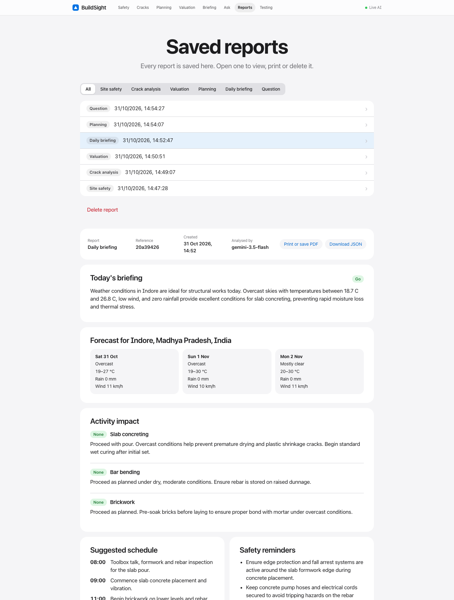
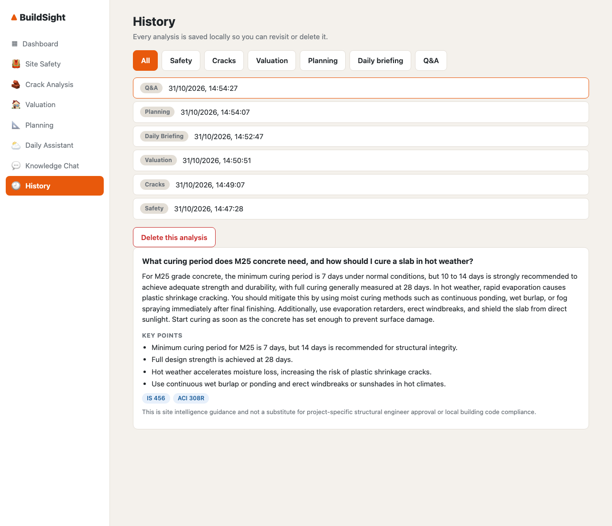

# Multimodal Construction Intelligence Platform

Full-stack decision-support system for construction. It takes **images, text and structured project
data** and returns strictly-typed JSON insights from a multimodal LLM — Google Gemini (free tier) or Claude.

| Module | What it does |
|---|---|
| Site Safety | PPE, fall protection, housekeeping, equipment hazards from site photos |
| Crack Analysis | Crack type, severity, probable causes, corrective actions, monitoring plan |
| Valuation | Indicative real-estate value with range, drivers and risks |
| Planning | Bill of materials, cost, dependency-aware schedule (Gantt), architectural concept + floor plan |
| Daily Assistant | Live weather (Open-Meteo) + planned work → go / caution / hold briefing |
| Knowledge Chat | Construction methods, materials, codes, safety Q&A |
| History | Every analysis saved to SQLite + disk; reopen or delete |

Every report can be printed / saved as PDF or downloaded as JSON. Requirements and acceptance
criteria are in [docs/REQUIREMENTS.md](docs/REQUIREMENTS.md).

## Screenshots

Real results from Gemini on the free tier (the test photos are simple generated illustrations).

| Dashboard | Site safety |
|---|---|
|  |  |
| **Crack analysis** | **Valuation** |
|  |  |
| **Planning** (costs, Gantt, floor plan) | **Daily site assistant** |
|  |  |
| **Knowledge chat** | |
|  | |

## Architecture

```
React (Vite)  ──/api──▶  FastAPI  ──▶  Gemini or Claude (vision + structured outputs)
                          │  └──▶ Open-Meteo (weather)
                          └──▶ SQLite + uploads/ (data storage)
```

* `backend/app/schemas.py` – the JSON contracts. They are sent to the model as its output schema
  (Gemini `response_schema` / Claude `output_config.format`), so responses always match what the UI renders.
* `backend/app/ai/client.py` – the only place that talks to the model. Checks why generation stopped
  (refusal, safety block, truncation) before parsing and maps API failures to clean HTTP errors.
* `backend/app/services/planning_math.py` – totals, grand cost and schedule start days are
  **recomputed server-side** (never trusted from the model); handles bad/cyclic dependencies.
* `backend/app/images.py` – validates uploads (type, size, truncated/corrupt files, tiny images),
  fixes EXIF rotation and downsizes to 1568 px.
* **Demo mode**: with no API key the API returns deterministic sample data in the same
  schema, so the whole app runs offline.

## Run

Prerequisites: Python 3.9+, Node 18+.

```bash
./run.sh
```

or manually:

```bash
cd backend && python3 -m venv .venv && .venv/bin/pip install -r requirements.txt
cp .env.example .env            # add GEMINI_API_KEY (free) or ANTHROPIC_API_KEY
.venv/bin/uvicorn app.main:app --reload --port 8000

cd frontend && npm install && npm run dev      # http://localhost:5173
```

## Configuration (`backend/.env`)

| Variable | Default | Notes |
|---|---|---|
| `GEMINI_API_KEY` | – | Free key from [AI Studio](https://aistudio.google.com/api-keys) |
| `GEMINI_MODEL` | `gemini-3.5-flash` | Any Gemini model your key can use (`gemini-3.8-flash` is newer but often busy on the free tier) |
| `GEMINI_FALLBACK_MODELS` | `gemini-3.5-flash-lite` | Tried in order when the model before is busy (503) or times out |
| `ANTHROPIC_API_KEY` | – | Claude key from the [Anthropic Console](https://console.anthropic.com) (prepaid) |
| `CLAUDE_MODEL` | `claude-opus-5-5` | `claude-sonnet-5-5` is cheaper/faster |
| `CLAUDE_EFFORT` | `medium` | `low`…`max`; higher = deeper analysis, more tokens |
| `AI_PROVIDER` | `auto` | Claude if its key is set, else Gemini; or force `anthropic` / `gemini` |
| `AI_MODE` | `auto` | `live` / `demo` to force; no key = demo |
| `MAX_IMAGES`, `MAX_IMAGE_MB` | 5, 10 | Upload limits |
| `APP_PASSWORD` | – | Set before deploying publicly; visitors must log in |
| `RATE_LIMIT_PER_HOUR` | 60 | AI requests per visitor IP per hour (0 = off) |
| `TRUST_PROXY` | false | `true` only behind a reverse proxy (Render, Railway, nginx) |

## Deploy (one URL)

Build the frontend once; the backend then serves it, so only one process is needed:

```bash
cd frontend && npm run build
cd ../backend && .venv/bin/uvicorn app.main:app --host 0.0.0.0 --port 8000   # open http://localhost:8000
```

On a host such as Render or Railway: build command
`pip install -r backend/requirements.txt && cd frontend && npm install && npm run build`, start command
`cd backend && uvicorn app.main:app --host 0.0.0.0 --port $PORT`, and set `ANTHROPIC_API_KEY`,
`APP_PASSWORD` and `TRUST_PROXY=true` as environment variables (use `GEMINI_API_KEY` instead of the Anthropic key for the free option). Saved history lives on local disk,
so use a persistent disk if you want it to survive redeploys.

**Before making it public, set `APP_PASSWORD`.** Without it anyone with the URL can spend your API credit.

### Vercel

The repo is ready for Vercel as-is: `vercel.json` builds the React app as static files and runs
the FastAPI backend as one Python function (`api/index.py`) for `/api/*` and `/uploads/*`.

```bash
vercel env add GEMINI_API_KEY production   # paste the key when asked
vercel deploy --prod
```

On Vercel the app stores history and photos in `/tmp`, and trusts Vercel's `X-Forwarded-For`
header automatically. Photos over 1.5 MB are resized in the browser before upload, because
Vercel limits a request to 4.5 MB.

## API

All analysis endpoints return `{id, kind, mode, model, created_at, image_urls, result, context}`.

* `POST /api/safety/analyze` – multipart: `images[]`, `notes`, `site_type`
* `POST /api/cracks/analyze` – multipart: `images[]`, `notes`, `element`
* `POST /api/valuation/estimate` – multipart: property fields + optional `images[]`
* `POST /api/planning/generate` – multipart: brief fields + optional `images[]`
* `POST /api/assistant/daily` – multipart: `location`, `activities`, `notes`, optional `images[]`
* `POST /api/knowledge/chat` – JSON `{messages:[{role,content}]}`
* `GET /api/history[?kind=]`, `GET|DELETE /api/history/{id}`, `GET /api/health`

Interactive docs: http://localhost:8000/docs

## Tests

```bash
cd backend && .venv/bin/python -m pytest -q
```

Covers every endpoint, upload edge cases (empty, corrupt, truncated, wrong format, too small,
too many), planning math, password gate and rate limiting, and both live provider paths (Claude and
Gemini) against a fake HTTP transport (request shape, refusals/safety blocks, truncation, auth and
rate-limit errors, malformed output).

## Known limitations

* Outputs are decision support, not certified inspections or appraisals.
* Crack widths and valuations are visual/market estimates; always involve a qualified engineer
  or valuer for real decisions.
* Weather needs internet access; without it the assistant falls back to general advice.
* Gemini free tier allows only a few requests per minute; Google may use free-tier inputs to
  improve its products, so avoid uploading sensitive photos.
* On Vercel, saved history is temporary: it lives in the function's `/tmp` and is lost when the
  function restarts. Use a host with a persistent disk (or an external database) to keep it.
